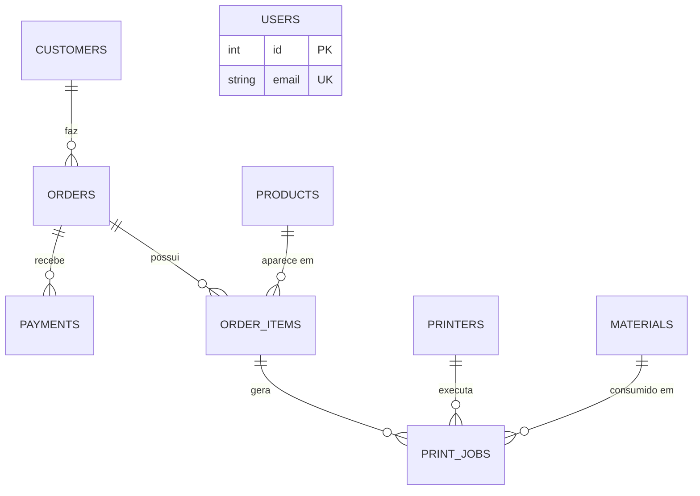

# API Impressão 3D

API REST para gerenciar a operação de um negócio de **impressão 3D sob demanda**: clientes, catálogo de produtos, estoque de filamentos/resinas, pedidos, pagamentos, parque de impressoras e a fila de trabalhos de impressão.

> **Status:** em desenvolvimento. A modelagem do banco (models e migrations) está bem avançada, mas boa parte das rotas ainda são *stubs* (retornam apenas uma mensagem). Veja a seção [Estado atual do projeto](#estado-atual-do-projeto).

---

## Sumário

- [Finalidade](#finalidade)
- [Tecnologias](#tecnologias)
- [Pré-requisitos](#pré-requisitos)
- [Instalação e configuração](#instalação-e-configuração)
- [Executando o projeto](#executando-o-projeto)
- [Testes](#testes)
- [Build](#build)
- [Scripts disponíveis](#scripts-disponíveis)
- [Rotas da API](#rotas-da-api)
- [Models](#models)
- [Enums](#enums)
- [Migrations](#migrations)
- [Estrutura de pastas](#estrutura-de-pastas)
- [Estado atual do projeto](#estado-atual-do-projeto)
- [Roadmap](#roadmap)
- [Contribuindo](#contribuindo)
- [Licença](#licença)

---

## Finalidade

O objetivo da API é centralizar o fluxo completo de uma operação de impressão 3D:

1. **Cadastro** de clientes e usuários internos (administradores, operadores).
2. **Catálogo** de produtos (peso, tempo de impressão, custo e preço de venda).
3. **Estoque** de materiais (PLA, PETG, ABS, TPU, resina), com alerta de estoque baixo e cálculo de custo por grama.
4. **Pedidos** com itens, desconto, valor final e status de andamento.
5. **Pagamentos** por PIX, cartão, dinheiro ou transferência.
6. **Produção:** controle das impressoras e dos *print jobs* (trabalhos de impressão), com tempo estimado x real, consumo de material e motivo de falha.

---

## Tecnologias

| Camada          | Tecnologia                                  |
| --------------- | ------------------------------------------- |
| Linguagem       | TypeScript                                  |
| Runtime         | Node.js                                     |
| Framework HTTP  | Express 5                                   |
| ORM             | Sequelize 6                                 |
| Banco de dados  | MySQL (driver `mysql2`)                     |
| Variáveis de ambiente | dotenv                                |
| Testes          | Vitest + Supertest                          |
| Dev server      | tsx (modo *watch*)                          |

---

## Pré-requisitos

- **Node.js** 20 ou superior e **npm**
- **MySQL** 8 (ou compatível, como MariaDB) em execução e acessível

---

## Instalação e configuração

```bash
# 1. Clone o repositório
git clone https://github.com/gabrieldev6/APIimpressao3d.git
cd APIimpressao3d

# 2. Instale as dependências
npm install

# 3. Crie o arquivo de variáveis de ambiente
cp .env.example .env
```

Edite o `.env` com os dados do seu MySQL:

| Variável      | Descrição                         | Padrão (se ausente) |
| ------------- | --------------------------------- | ------------------- |
| `PORT`        | Porta em que a API vai escutar    | `3000`              |
| `DB_HOST`     | Host do MySQL                     | `localhost`         |
| `DB_PORT`     | Porta do MySQL                    | `3306`              |
| `DB_NAME`     | Nome do banco                     | `impressao3d`       |
| `DB_USER`     | Usuário do banco                  | `root`              |
| `DB_PASSWORD` | Senha do banco                    | `sua_senha`         |

Exemplo:

```env
PORT=3000

# Database configuration
DB_HOST=localhost
DB_PORT=3306
DB_NAME=impressao3d
DB_USER=root
DB_PASSWORD=minha_senha
```

Crie o banco de dados vazio:

```sql
CREATE DATABASE impressao3d CHARACTER SET utf8mb4 COLLATE utf8mb4_unicode_ci;
```

> ⚠️ Nunca faça commit do arquivo `.env`. Ele já está no `.gitignore`.

---

## Executando o projeto

### Modo desenvolvimento (recarrega ao salvar)

```bash
npm run dev
```

### Modo produção

```bash
npm run build
node dist/server.js
```

Ao iniciar, o servidor autentica no banco e executa `sequelize.sync()`, que **cria as tabelas automaticamente** caso ainda não existam. Se tudo der certo, você verá:

```
Conexão com o banco estabelecida.
Servidor rodando na porta 3000
```

A API fica disponível em `http://localhost:3000`.

---

## Testes

Os testes usam **Vitest** (com **Supertest** para chamadas HTTP) e ficam na pasta `tests/`.

```bash
# Executa todos os testes uma vez
npm test

# Modo watch (reexecuta ao salvar)
npm run test:watch
```

Organização:

| Pasta                | Conteúdo                                              |
| -------------------- | ----------------------------------------------------- |
| `tests/unit/`        | Testes unitários dos models (ex.: `user.test.ts`)     |
| `tests/integration/` | Testes de integração (reservada)                      |
| `tests/e2e/`         | Testes ponta a ponta (reservada)                      |
| `tests/health.test.ts` | Teste de saúde da aplicação via Supertest           |

Os testes unitários dos models usam `Model.build()`, então **não precisam de conexão com o banco**.

### Cobertura (opcional)

O `vitest.config.ts` já está configurado para cobertura com o provider `v8`. Instale o pacote e execute:

```bash
npm install -D @vitest/coverage-v8
npx vitest run --coverage
```

O relatório é gerado no terminal e em HTML (pasta `coverage/`).

---

## Build

O build compila o TypeScript de `src/` para JavaScript em `dist/`, conforme o `tsconfig.json`:

```bash
npm run build
```

Depois, para rodar a versão compilada:

```bash
node dist/server.js
```

> A pasta `dist/` está no `.gitignore` e não deve ser versionada.

---

## Scripts disponíveis

| Script               | Comando             | O que faz                                          |
| -------------------- | ------------------- | -------------------------------------------------- |
| `npm run dev`        | `tsx watch src/server.ts` | Sobe a API em modo desenvolvimento           |
| `npm run build`      | `tsc`               | Compila o projeto para `dist/`                     |
| `npm start`          | `node dist/index.js`| Executa o build (veja a observação abaixo)         |
| `npm test`           | `vitest run`        | Roda a suíte de testes uma vez                     |
| `npm run test:watch` | `vitest`            | Roda os testes em modo watch                       |

> **Observação:** o ponto de entrada que inicia o servidor é `src/server.ts` (compilado para `dist/server.js`). Hoje o script `start` aponta para `dist/index.js`, que não sobe o servidor. Recomenda-se alterá-lo para `node dist/server.js`.

---

## Rotas da API

URL base: `http://localhost:3000/api`

O corpo das requisições e das respostas é JSON (`Content-Type: application/json`).

### Usuários — `/api/users`

| Método   | Rota             | Descrição                    | Situação                         |
| -------- | ---------------- | ---------------------------- | -------------------------------- |
| `POST`   | `/api/users`     | Cria um usuário              | Usa o `UserController` (ver nota)|
| `GET`    | `/api/users`     | Lista todos os usuários      | Usa o `UserController` (ver nota)|
| `GET`    | `/api/users/:id` | Busca um usuário pelo id     | Usa o `UserController` (ver nota)|
| `PATCH`  | `/api/users/:id` | Atualiza um usuário          | *Stub*                           |
| `DELETE` | `/api/users/:id` | Remove um usuário            | *Stub*                           |

**Criar usuário** — `POST /api/users`

```json
{
  "name": "Maria Silva",
  "email": "maria@example.com",
  "password": "senha-segura",
  "role": "OPERATOR"
}
```

`role` é opcional (padrão `USER`) e aceita `ADMIN`, `OPERATOR` ou `USER`.

Respostas previstas pelo controller:

| Status | Quando                                  |
| ------ | --------------------------------------- |
| `201`  | Usuário criado                          |
| `400`  | Dados inválidos (ex.: e-mail malformado)|
| `409`  | E-mail já cadastrado                    |
| `500`  | Erro interno                            |

O campo `password` **não é retornado** nas consultas (o model usa um `defaultScope` que o exclui).

> **Nota:** na versão atual, `user.routes.ts` chama o controller sem `await` e envia a própria resposta em seguida, o que pode gerar o erro *"Cannot set headers after they are sent"*. Veja [Estado atual do projeto](#estado-atual-do-projeto).

### Produtos — `/api/products`

| Método   | Rota                 | Descrição                  | Situação |
| -------- | -------------------- | -------------------------- | -------- |
| `POST`   | `/api/products`      | Cria um produto            | *Stub*   |
| `GET`    | `/api/products`      | Lista os produtos          | *Stub*   |
| `GET`    | `/api/products/:id`  | Busca um produto pelo id   | *Stub*   |
| `PATCH`  | `/api/products/:id`  | Atualiza um produto        | *Stub*   |
| `DELETE` | `/api/products/:id`  | Remove um produto          | *Stub*   |

### Materiais — `/api/materials`

| Método   | Rota                  | Descrição                   | Situação |
| -------- | --------------------- | --------------------------- | -------- |
| `POST`   | `/api/materials`      | Cria um material            | *Stub*   |
| `GET`    | `/api/materials`      | Lista os materiais          | *Stub*   |
| `GET`    | `/api/materials/:id`  | Busca um material pelo id   | *Stub*   |
| `PATCH`  | `/api/materials/:id`  | Atualiza um material        | *Stub*   |
| `DELETE` | `/api/materials/:id`  | Remove um material          | *Stub*   |

### Pedidos — `/api/orders`

| Método   | Rota               | Descrição                 | Situação |
| -------- | ------------------ | ------------------------- | -------- |
| `POST`   | `/api/orders`      | Cria um pedido            | *Stub*   |
| `GET`    | `/api/orders`      | Lista os pedidos          | *Stub*   |
| `GET`    | `/api/orders/:id`  | Busca um pedido pelo id   | *Stub*   |
| `PATCH`  | `/api/orders/:id`  | Atualiza um pedido        | *Stub*   |
| `DELETE` | `/api/orders/:id`  | Remove um pedido          | *Stub*   |

> *Stub* = a rota existe e responde com o status HTTP correto e uma mensagem, mas ainda não acessa o banco de dados.

---

## Models

Todos os models estão em `src/models/`, são escritos com Sequelize + TypeScript (`InferAttributes`) e usam `INTEGER UNSIGNED` com auto incremento como chave primária. As associações são declaradas em `src/models/index.ts`.

### Diagrama de relacionamentos



### `User` — tabela `users`

Usuários internos do sistema.

| Campo        | Tipo            | Observações                                   |
| ------------ | --------------- | --------------------------------------------- |
| `id`         | INTEGER UNSIGNED| PK, auto incremento                           |
| `name`       | STRING(120)     | Obrigatório                                   |
| `email`      | STRING(150)     | Obrigatório, único, validado como e-mail      |
| `password`   | STRING(255)     | Obrigatório; oculto por padrão (scope `withPassword` o inclui) |
| `role`       | ENUM            | `ADMIN`, `OPERATOR`, `USER` (padrão `USER`)   |
| `isActivate` | BOOLEAN         | Padrão `true`                                 |
| `createdAt` / `updatedAt` | DATE | Timestamps                              |

Métodos: `isAdmin()`, `activate()`, `deactivate()`.

### `Customer` — tabela `customers`

| Campo      | Tipo         | Observações                  |
| ---------- | ------------ | ---------------------------- |
| `id`       | INTEGER UNSIGNED | PK                       |
| `name`     | STRING(120)  | Obrigatório                  |
| `email`    | STRING(150)  | Obrigatório, único           |
| `phone`    | STRING(20)   | Obrigatório                  |
| `document` | STRING(20)   | CPF/CNPJ; obrigatório, único |
| `address`  | STRING(200)  | Obrigatório                  |
| `city`     | STRING(100)  | Obrigatório                  |
| `state`    | STRING(2)    | UF; obrigatório              |
| `zipCode`  | STRING(10)   | CEP; obrigatório             |

Métodos: `getFullAddress()`.

### `Product` — tabela `products`

| Campo         | Tipo          | Observações                       |
| ------------- | ------------- | --------------------------------- |
| `id`          | INTEGER UNSIGNED | PK                             |
| `name`        | STRING(150)   | Obrigatório                       |
| `description` | TEXT          | Obrigatório                       |
| `sku`         | STRING(50)    | Obrigatório, único                |
| `category`    | STRING(100)   | Obrigatório                       |
| `weight`      | DECIMAL(10,2) | Peso (g)                          |
| `printTime`   | INTEGER UNSIGNED | Tempo de impressão             |
| `cost`        | DECIMAL(10,2) | Custo de produção                 |
| `price`       | DECIMAL(10,2) | Preço de venda                    |
| `isActive`    | BOOLEAN       | Padrão `true`                     |

Métodos: `calculateProfit()`, `calculateTotalCost(quantity)`, `deactivate()`.

### `Material` — tabela `materials`

| Campo           | Tipo             | Observações                             |
| --------------- | ---------------- | --------------------------------------- |
| `id`            | INTEGER UNSIGNED | PK                                      |
| `name`          | STRING(100)      | Obrigatório                             |
| `type`          | ENUM             | `PLA`, `PETG`, `ABS`, `TPU`, `RESIN`, `OTHER` |
| `color`         | STRING(50)       | Obrigatório                             |
| `brand`         | STRING(100)      | Obrigatório                             |
| `diameter`      | DECIMAL(4,2)     | Padrão `1.75` (mm)                      |
| `pricePerKg`    | DECIMAL(10,2)    | Obrigatório                             |
| `stockGrams`    | INTEGER UNSIGNED | Padrão `0`                              |
| `minStockGrams` | INTEGER UNSIGNED | Padrão `500` (limite de estoque baixo)  |

Métodos: `hasLowStock()`, `calculateCost(grams)`.

### `Printer` — tabela `printers`

| Campo            | Tipo             | Observações                                        |
| ---------------- | ---------------- | -------------------------------------------------- |
| `id`             | INTEGER UNSIGNED | PK                                                 |
| `name`           | STRING(100)      | Obrigatório                                        |
| `model`          | STRING(100)      | Obrigatório                                        |
| `manufacturer`   | STRING(100)      | Obrigatório                                        |
| `status`         | ENUM             | `AVAILABLE`, `PRINTING`, `MAINTENANCE`, `INACTIVE` (padrão `AVAILABLE`) |
| `nozzleDiameter` | DECIMAL(4,2)     | Padrão `0.4` (mm)                                  |
| `maxTemperature` | INTEGER UNSIGNED | Obrigatório (°C)                                   |
| `notes`          | TEXT             | Opcional                                           |

Métodos: `isAvailable()`, `startPrinting()`.

### `Order` — tabela `orders`

| Campo         | Tipo             | Observações                                   |
| ------------- | ---------------- | --------------------------------------------- |
| `id`          | INTEGER UNSIGNED | PK                                            |
| `customerId`  | INTEGER UNSIGNED | FK → `customers.id`                           |
| `status`      | ENUM             | `PENDING`, `APPROVED`, `IN_PRODUCTION`, `COMPLETED`, `CANCELLED` (padrão `PENDING`) |
| `totalAmount` | DECIMAL(10,2)    | Padrão `0`                                    |
| `discount`    | DECIMAL(10,2)    | Padrão `0`                                    |
| `finalAmount` | DECIMAL(10,2)    | Padrão `0`                                    |
| `notes`       | TEXT             | Opcional                                      |

Métodos: `calculateFinalAmount()`, `isCompleted()`, `cancel()` (não cancela pedido concluído).

### `OrderItem` — tabela `order_items`

Sem `createdAt`/`updatedAt`.

| Campo       | Tipo             | Observações            |
| ----------- | ---------------- | ---------------------- |
| `id`        | INTEGER UNSIGNED | PK                     |
| `orderId`   | INTEGER UNSIGNED | FK → `orders.id`       |
| `productId` | INTEGER UNSIGNED | FK → `products.id`     |
| `quantity`  | INTEGER UNSIGNED | Mínimo 1               |
| `unitPrice` | DECIMAL(10,2)    | Preço unitário         |
| `subtotal`  | DECIMAL(10,2)    | Quantidade × preço     |

Métodos: `calculateSubtotal()`.

### `Payment` — tabela `payments`

Possui apenas `createdAt` (sem `updatedAt`).

| Campo           | Tipo             | Observações                                         |
| --------------- | ---------------- | --------------------------------------------------- |
| `id`            | INTEGER UNSIGNED | PK                                                  |
| `orderId`       | INTEGER UNSIGNED | FK → `orders.id`                                    |
| `amount`        | DECIMAL(10,2)    | Mínimo `0.01`                                       |
| `method`        | ENUM             | `PIX`, `CREDIT_CARD`, `DEBIT_CARD`, `CASH`, `BANK_TRANSFER` |
| `status`        | ENUM             | `PENDING`, `APPROVED`, `REJECTED`, `REFUNDED` (padrão `PENDING`) |
| `transactionId` | STRING(255)      | Opcional                                            |
| `paidAt`        | DATE             | Opcional                                            |

Métodos: `isPaid()`, `markAsPaid()`.

### `PrintJob` — tabela `print_jobs`

| Campo               | Tipo             | Observações                                  |
| ------------------- | ---------------- | -------------------------------------------- |
| `id`                | INTEGER UNSIGNED | PK                                           |
| `orderItemId`       | INTEGER UNSIGNED | FK → `order_items.id`                        |
| `printerId`         | INTEGER UNSIGNED | FK → `printers.id`                           |
| `materialId`        | INTEGER UNSIGNED | FK → `materials.id`                          |
| `status`            | ENUM             | `PENDING`, `PRINTING`, `COMPLETED`, `FAILED`, `CANCELLED` (padrão `PENDING`) |
| `quantity`          | INTEGER UNSIGNED | Mínimo 1                                     |
| `estimatedTime`     | INTEGER UNSIGNED | Tempo estimado                               |
| `actualTime`        | INTEGER UNSIGNED | Tempo real (opcional)                        |
| `materialUsedGrams` | DECIMAL(10,2)    | Padrão `0`                                   |
| `startedAt` / `finishedAt` | DATE      | Opcionais                                    |
| `failureReason`     | TEXT             | Opcional                                     |
| `notes`             | TEXT             | Opcional                                     |

Métodos: `start()`, `finish(actualTime, materialUsedGrams)`, `fail(reason)` — cada transição valida o status atual.

---

## Enums

Definidos em `src/types/enums.ts`:

| Enum            | Valores                                                         |
| --------------- | --------------------------------------------------------------- |
| `UserRole`      | `ADMIN`, `OPERATOR`, `USER`                                     |
| `MaterialType`  | `PLA`, `PETG`, `ABS`, `TPU`, `RESIN`, `OTHER`                   |
| `OrderStatus`   | `PENDING`, `APPROVED`, `IN_PRODUCTION`, `COMPLETED`, `CANCELLED`|
| `PaymentMethod` | `PIX`, `CREDIT_CARD`, `DEBIT_CARD`, `CASH`, `BANK_TRANSFER`     |
| `PaymentStatus` | `PENDING`, `APPROVED`, `REJECTED`, `REFUNDED`                   |
| `PrinterStatus` | `AVAILABLE`, `PRINTING`, `MAINTENANCE`, `INACTIVE`              |
| `PrintJobStatus`| `PENDING`, `PRINTING`, `COMPLETED`, `FAILED`, `CANCELLED`       |

---

## Migrations

A pasta `migrations/` contém migrations no formato do **sequelize-cli**, uma por tabela, na ordem das dependências (clientes → materiais → usuários → impressoras → produtos → pedidos → itens → pagamentos → print jobs). As credenciais para o CLI ficam em `config/config.json`.

Hoje o servidor cria as tabelas por conta própria com `sequelize.sync()`, então as migrations são opcionais. Para usá-las no lugar do `sync`:

```bash
npm install -D sequelize-cli
npx sequelize-cli db:migrate        # aplica as migrations
npx sequelize-cli db:migrate:undo   # desfaz a última
```

---

## Estrutura de pastas

```
.
├── config/                 # Credenciais do sequelize-cli (config.json)
├── migrations/             # Migrations do Sequelize
├── models/                 # index.js gerado pelo sequelize-cli
├── src/
│   ├── config/
│   │   └── database.ts     # Instância do Sequelize (lê o .env)
│   ├── controllers/
│   │   └── UserController.ts
│   ├── models/             # Models + associações (index.ts)
│   ├── routes/             # user, product, material e order
│   ├── types/
│   │   └── enums.ts
│   ├── app.ts              # Configuração do Express e das rotas
│   ├── server.ts           # Ponto de entrada (conecta ao banco e sobe o servidor)
│   └── index.ts
├── tests/
│   ├── unit/
│   ├── integration/
│   ├── e2e/
│   └── health.test.ts
├── .env.example
├── package.json
├── tsconfig.json
└── vitest.config.ts
```

---

## Estado atual do projeto

Para quem for contribuir, estes são os pontos conhecidos que ainda precisam de atenção:

- **Rotas de produtos, materiais e pedidos** são *stubs*: não acessam o banco.
- **Rotas de usuários (`POST`, `GET`, `GET /:id`)** chamam o `UserController` sem `await` e depois respondem por conta própria; a resposta do controller e a da rota competem entre si. O ideal é `await UserController.store(req, res)` (ou registrar `UserController.store` diretamente como handler) e remover a segunda resposta.
- **`PATCH` e `DELETE` de usuários** ainda são *stubs*.
- **Senhas** são gravadas como recebidas; falta aplicar hash (ex.: `bcrypt`) antes de salvar.
- **Não há autenticação/autorização** (o model já prevê `role`, mas nenhum middleware o utiliza).
- **`tests/health.test.ts`** faz `GET /` esperando `200`, mas a aplicação ainda não define a rota `/` (nem `/health`); o teste falha até ela ser criada.
- **Script `start`** aponta para `dist/index.js` em vez de `dist/server.js`.
- **Migration `print_jobs`** (`20261024000900-create-print-jobs.js`) está vazia.
- **Tamanho das colunas decimais** em algumas migrations difere dos models (ex.: `orders` usa `DECIMAL(12,2)`, o model usa `DECIMAL(10,2)`).
- `vitest` e `supertest` estão em `dependencies`; o mais adequado é `devDependencies`.

---

## Roadmap

- [ ] Implementar CRUD completo de usuários, produtos, materiais e pedidos
- [ ] Criar rotas para clientes, impressoras, pagamentos e print jobs
- [ ] Rota de *health check* (`GET /health`)
- [ ] Hash de senhas e autenticação com JWT
- [ ] Controle de acesso por `role`
- [ ] Validação de entrada (ex.: Zod)
- [ ] Baixa automática de estoque de material ao concluir um print job
- [ ] Testes de integração e e2e
- [ ] Documentação interativa (Swagger/OpenAPI)
- [ ] Dockerfile e `docker-compose` com MySQL
- [ ] Pipeline de CI (GitHub Actions)

---

## Contribuindo

1. Faça um *fork* do projeto
2. Crie uma branch: `git checkout -b feature/minha-feature`
3. Faça o commit: `git commit -m "feat: minha feature"`
4. Envie a branch: `git push origin feature/minha-feature`
5. Abra um *Pull Request*

Antes de abrir o PR, rode `npm test` e `npm run build`.

---

## Licença

Distribuído sob a licença **ISC**, conforme definido no `package.json`.

---

Desenvolvido por [gabrieldev6](https://github.com/gabrieldev6).
